# 🔐 Cybersecurity Lab Environment Setup

**Building an isolated virtual lab for penetration testing and ethical hacking practice**

`VirtualBox 7.2.22` · `Kali Linux 2026.2` · `NAT Network 10.0.0.0/24` · `Windows 10 Host`

---

## 📌 Project Overview

This project documents the setup of a virtual cybersecurity and penetration-testing laboratory using **Oracle VirtualBox** and **Kali Linux**.

The lab provides a controlled and repeatable environment in which security tools, network scanning, reconnaissance and vulnerability assessment can be practised safely. It runs on a private virtual network so that additional target machines can be added in future projects.

---

## 📝 Assignment Task (Week 1)

The task given for Week 1 was to set up a cybersecurity testing lab environment on a laptop/PC with the following requirements:

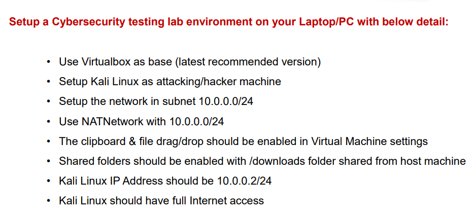

| # | Requirement | Status |
|---|-------------|--------|
| 1 | Use VirtualBox as base (latest recommended version) | ✅ Completed (VirtualBox 7.2.22) |
| 2 | Set up Kali Linux as the attacking/hacker machine | ✅ Completed |
| 3 | Set up the network in subnet 10.0.0.0/24 | ✅ Completed |
| 4 | Use NATNetwork with 10.0.0.0/24 | ✅ Completed (`LabNet`) |
| 5 | Clipboard and file drag/drop enabled in VM settings | ✅ Enabled (Bidirectional). See [Known Issue](#-known-issue-clipboard-and-drag-and-drop-at-runtime) |
| 6 | Shared folder enabled with the host Downloads folder | ✅ Configured (see Step 8) |
| 7 | Kali Linux IP address should be 10.0.0.2/24 | ✅ Completed |
| 8 | Kali Linux should have full Internet access | ✅ Completed |

---

## 🛡️ Purpose of the Lab

The lab can be used for activities such as:

- Network reconnaissance and port scanning
- Vulnerability assessment
- Packet analysis
- Web application security testing
- Exploitation practice and security-tool experimentation

> ⚠️ **Important:** This laboratory must only be used against systems that you own or have explicit written permission to test. Do not use the lab or its tools against unauthorized systems.

---

## 🏗️ Lab Architecture

```
                 Windows 10 Host (8 GB RAM)
                          │
                  Oracle VirtualBox 7.2.22
                          │
            ┌─────────────┴─────────────┐
            │   NAT Network "LabNet"    │
            │       10.0.0.0/24         │
            │   Gateway: 10.0.0.1       │
            └─────────────┬─────────────┘
                          │
                 Kali Linux 2026.2 VM
                    10.0.0.2/24
                          │
                    Internet access
```

Additional target machines can be attached to the same `LabNet` network in future projects.

---

## ⚙️ Lab Configuration

| Component | Configuration |
|-----------|---------------|
| Host OS | Windows 10 |
| Host RAM | 8 GB |
| Hypervisor | Oracle VirtualBox 7.2.22 |
| Attacker OS | Kali Linux 2026.2 (`kali-linux-2026.2-virtualbox-amd64`) |
| Kali RAM | 1536 MB |
| Virtual network | NAT Network `LabNet` |
| Network address | 10.0.0.0/24 (DHCP enabled, IPv6 disabled) |
| Kali IP address | 10.0.0.2/24 (static) |
| Default gateway | 10.0.0.1 |
| DNS server | 8.8.8.8 |
| Adapter type | Intel PRO/1000 MT Desktop (82540EM) |
| Shared clipboard / Drag-and-Drop | Bidirectional |

---

## 🪜 Lab Setup Procedure

### Step 1. Install 7-Zip

7-Zip was used to extract the Kali Linux virtual-machine package, which is distributed as a `.7z` archive. **7-Zip 25.01 (x64)** was already installed on the host system.

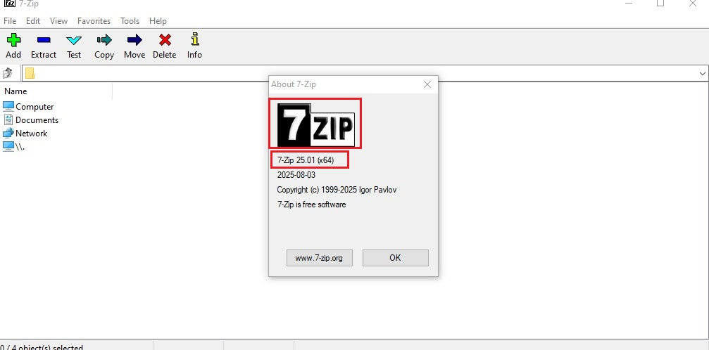

### Step 2. Install VirtualBox

Oracle VirtualBox was used as the hypervisor. The installed version is **7.2.22**, as shown in the *About* window.

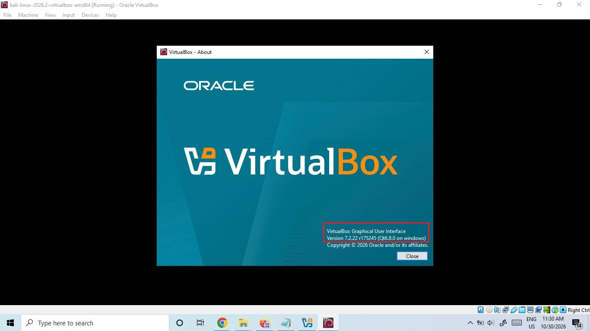

### Step 3. Create the NAT Network

A dedicated NAT Network was created so that multiple virtual machines can communicate with each other and still reach the Internet.

**3a. Open the Network section** in VirtualBox Manager.

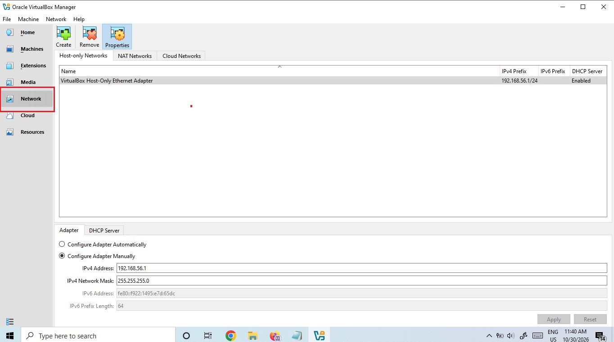

**3b. Open the NAT Networks tab** and use *Create* (the default `NatNetwork` entry used 10.0.2.0/24).

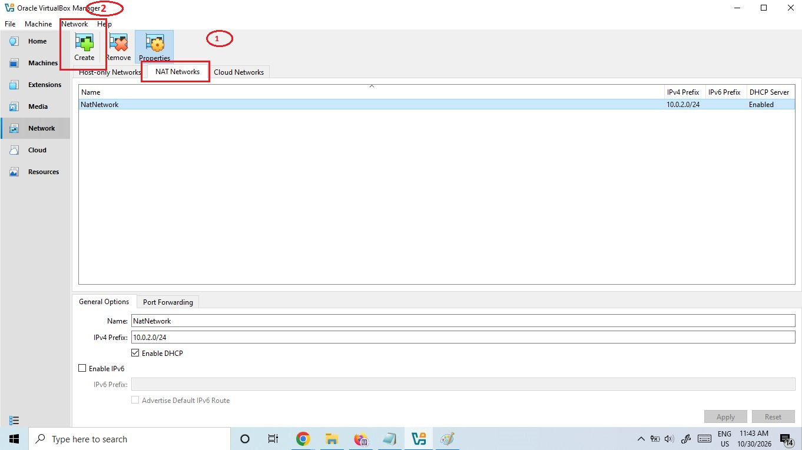

**3c. Set the name and prefix:**

- Name: `LabNet`
- IPv4 Prefix: `10.0.0.0/24`
- Enable DHCP: ✔
- Enable IPv6: ✘

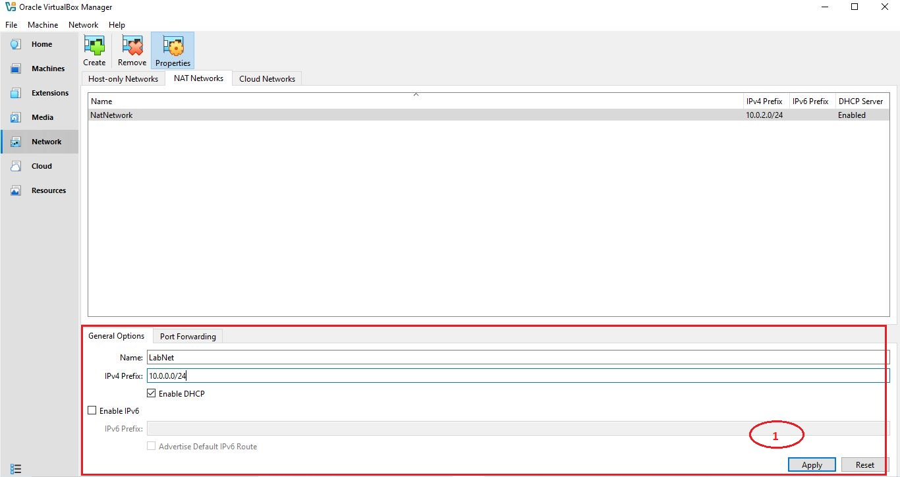

**3d. Result:** the `LabNet` network is listed with prefix `10.0.0.0/24` and DHCP enabled.

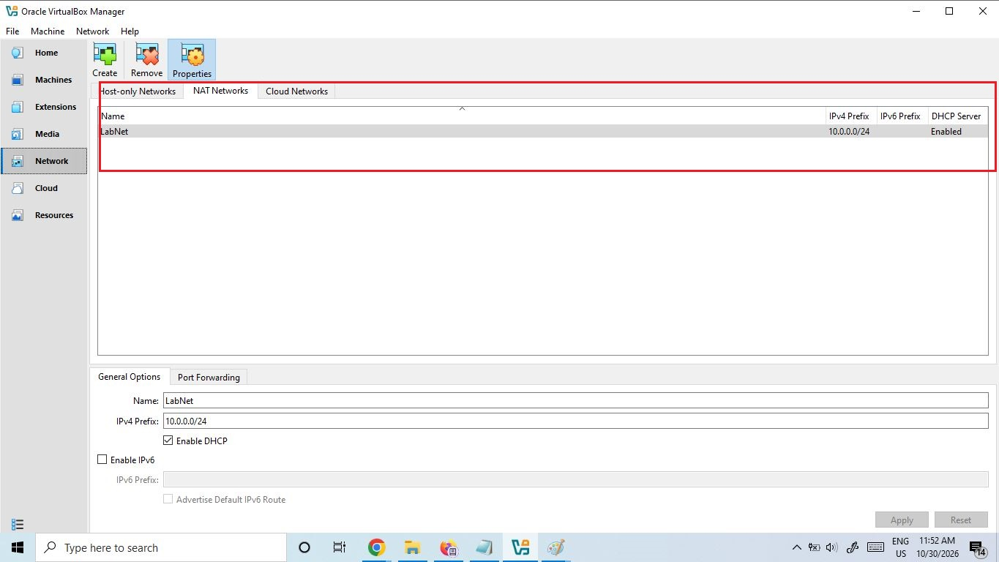

### Step 4. Import Kali Linux and attach it to LabNet

The official Kali Linux VirtualBox image was imported into VirtualBox. In the VM settings, **Adapter 1** was configured as:

- Attached to: **NAT Network**
- Name: **LabNet**
- Adapter type: Intel PRO/1000 MT Desktop (82540EM)

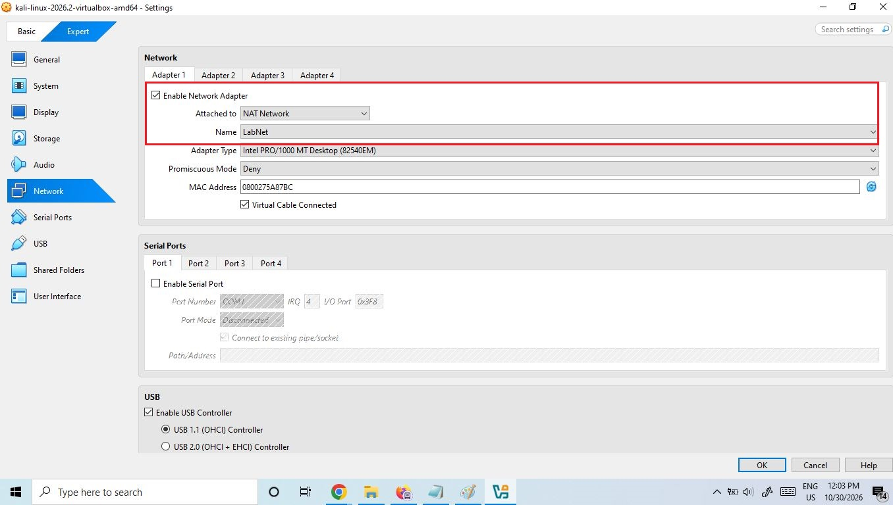

### Step 5. Configure the Kali Linux IP address (10.0.0.2/24)

The static IPv4 address was configured with `nmcli` on the connection `Wired connection 1`.

**5a. Set the static IP, gateway and DNS:**

```bash
sudo nmcli con mod "Wired connection 1" ipv4.method manual \
  ipv4.addresses 10.0.0.2/24 ipv4.gateway 10.0.0.1 \
  ipv4.dns 8.8.8.8 ipv4.dad-timeout 0
```

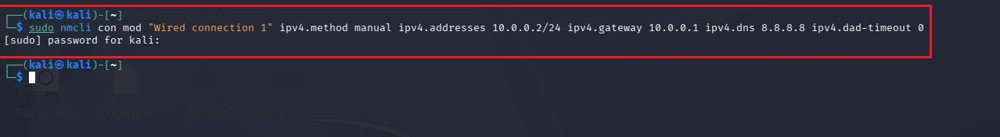

**5b. Restart the connection** to apply the settings:

```bash
sudo nmcli con down "Wired connection 1" && sudo nmcli con up "Wired connection 1"
```

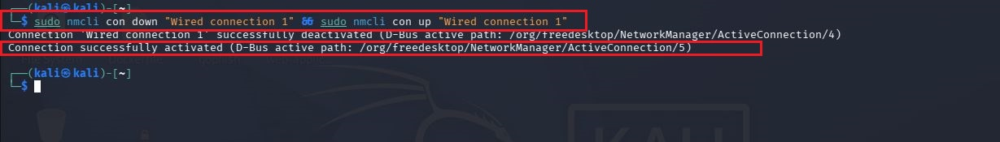

**5c. Verify the address** with `ip a`. Interface `eth0` is **UP** with `10.0.0.2/24`.

```bash
ip a
```

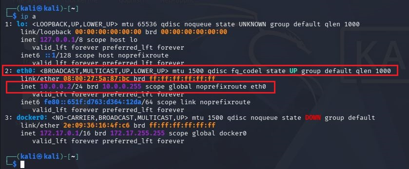

**5d. The same settings as seen in the Network Manager GUI** (Method: Manual, Address 10.0.0.2, Netmask 24, Gateway 10.0.0.1, DNS 8.8.8.8).

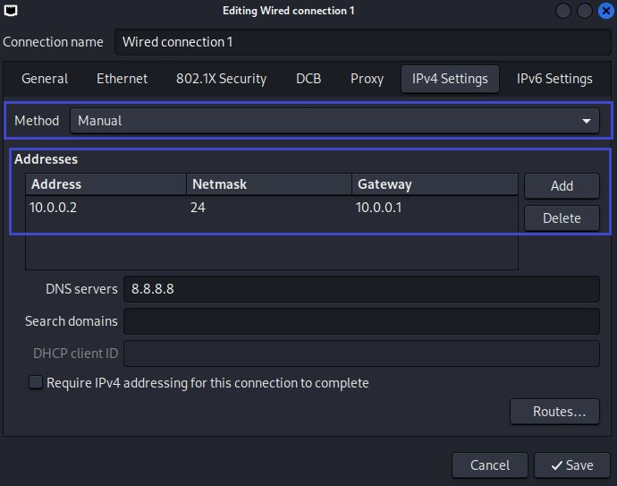

### Step 6. Verify full Internet access

Three tests were run from the Kali VM, each with 4 packets and **0% packet loss**.

| Test | Command | Result |
|------|---------|--------|
| Gateway reachable | `ping -c 4 10.0.0.1` | 4/4 replies |
| Internet by IP | `ping -c 4 8.8.8.8` | 4/4 replies |
| Internet by name (DNS) | `ping -c 4 google.com` | 4/4 replies, name resolved |

**6a. Gateway**

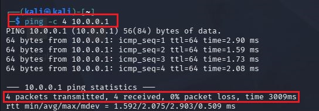

**6b. Internet (IP address)**

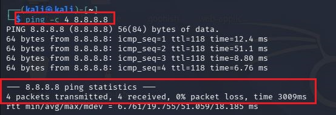

**6c. Internet (DNS name)**

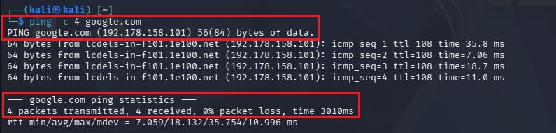

### Step 7. Enable Shared Clipboard and Drag-and-Drop

In the VM settings under **General → Features**, both options were set to **Bidirectional**.

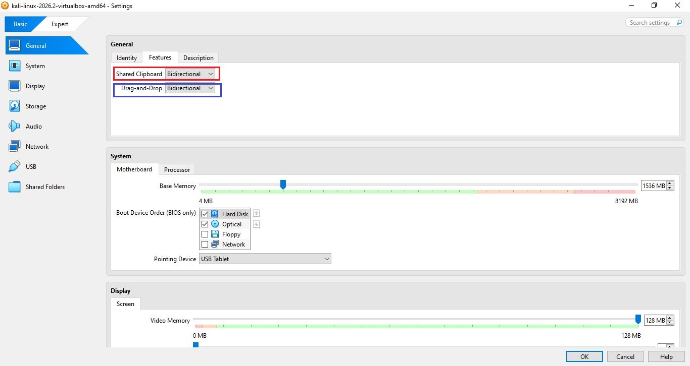

### Step 8. Shared folder (host Downloads folder)

The Windows **Downloads** folder was added as a VirtualBox shared folder and is available inside Kali at `/media/sf_Downloads`.

<!-- TODO: add screenshots before publishing:


-->

### Step 9. Clean VM snapshot

<!-- TODO: take the snapshot (Machine > Take Snapshot, e.g. "Clean Kali - Network Setup") and add:

-->

A snapshot of the configured VM serves as the clean baseline of the laboratory, so the machine can be restored if a later exercise breaks the configuration.

---

## 🐞 Known Issue: Clipboard and Drag-and-Drop at Runtime

Both features are **enabled in the VM settings** (Step 7), but copy/paste and drag-and-drop between the Windows host and Kali did not work at runtime. The cause was investigated inside the guest:

| Check | Result |
|-------|--------|
| `ps aux \| grep -i vboxclient` | `VBoxClient` clipboard helper was not running |
| `VBoxClient --clipboard` | Failed with `VERR_FILE_NOT_FOUND` |
| `lsmod \| grep vbox` and `ls -l /dev/vbox*` | `vboxguest` module loaded, but no `/dev/vbox*` device files were created |

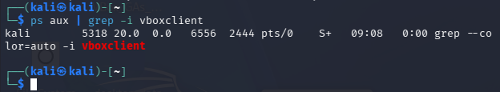

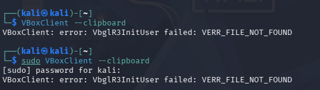

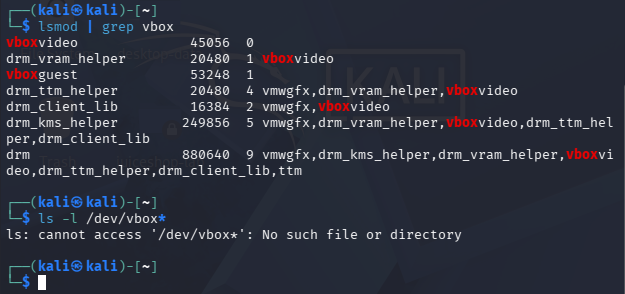

**Analysis:** The VirtualBox Guest Additions packages in Kali (`7.2.20`) are older than the host VirtualBox (`7.2.22`), and Kali's kernel (`6.19.14+kali-amd64`) provides its own built-in `vboxguest`/`vboxsf` modules. The kernel log also reports `Running outdated vboxsf module`. Because the guest driver does not create `/dev/vboxuser`, the clipboard service cannot start.

**Planned fix:** update the Kali kernel, kernel headers and Guest Additions to matching versions (`linux-image-amd64`, `linux-headers-amd64`, `virtualbox-guest-utils`, `virtualbox-guest-x11`), reboot, then re-test clipboard and drag-and-drop.

> This section will be updated with the result once the fix has been applied and verified.

---

## 🔎 Lab Verification Summary

| Test | Command | Result |
|------|---------|--------|
| IP address | `ip a` | `eth0` = 10.0.0.2/24, state UP |
| Gateway | `ping -c 4 10.0.0.1` | 0% packet loss |
| Internet (IP) | `ping -c 4 8.8.8.8` | 0% packet loss |
| DNS / Internet (name) | `ping -c 4 google.com` | Resolved, 0% packet loss |

---

## 💡 What I Learned

1. **NAT vs NAT Network.** A NAT Network lets several VMs share one private network (10.0.0.0/24) and still reach the Internet, which suits a multi-machine lab.
2. **Static addressing with `nmcli`.** Setting address, gateway, DNS and verifying with `ip a` and `ping`.
3. **Guest Additions matter.** Clipboard, drag-and-drop and shared folders depend on the guest driver and tools matching the host VirtualBox version.
4. **Systematic troubleshooting.** Checking the running process, then the kernel module, then the device files, then the logs narrowed the problem down.
5. **Documentation.** Recording commands, screenshots, problems and fixes is a core part of professional security work.

---

## 🔐 Security & Ethical Use

This laboratory is intended strictly for education and authorized security testing.

---

## 🔗 Tools & Resources

- 7-Zip: https://7-zip.org/download.html
- VirtualBox: https://virtualbox.org/wiki/Downloads
- Kali Linux: https://kali.org/get-kali

---

## 📁 Repository Structure

```
NETWORKWALKS-B082-WK1-PM1-CYBERSECURITY-LAB-SETUP/
├── README.md
└── screenshots/
    ├── 00-assignment-task.png
    ├── 1-screenshot-7zip-installed.jpg
    ├── 2-screenshot-VirtualBox-installed.jpg
    ├── 3a ... 3d  (NAT Network creation)
    ├── 4-vm-network-adapter.jpg
    ├── 5a ... 5d  (static IP configuration)
    ├── 6a ... 6c  (connectivity tests)
    ├── 7-clipboard-dragdrop.jpg
    └── 7a ... 7c  (clipboard troubleshooting)
```

---

## 👤 Author

**Megha**
GitHub: [meghaInfosec](https://github.com/meghaInfosec)

---

## 📌 Project Information

**Week:** 01 · **Task:** WK1-PM1 · **Project:** Cybersecurity & Pentesting Lab Setup · **Repository:** GitHub
